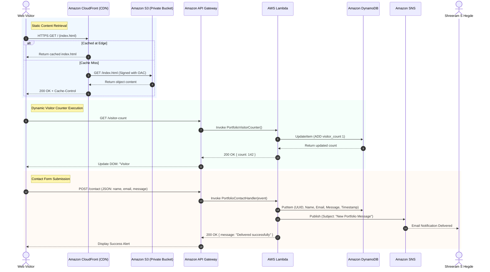

# Cloud Architecture & AWS Services Deep Dive

**Project**: Serverless Portfolio Hosting on AWS  
**Author**: Shreeram S Hegde (USN: 4NI24IS187)  
**Course**: BIS505 – Cloud Computing Experiential Learning (NIE Mysuru)  

---

## 1. Architectural Philosophy & Strategy

Traditional web hosting relies on provisioned virtual machines (like **Amazon EC2**) running web server software (Apache, Nginx, or Node.js). While versatile, virtual machines introduce significant administrative and financial burdens:
- Operating system patching, kernel updates, and security hardening.
- Constant running costs (paying for 24/7 idle CPU and RAM).
- Single-point-of-failure risks unless complex multi-AZ auto-scaling groups and Application Load Balancers (ALB) are configured.

### The Serverless Alternative
This project adheres to the **AWS Well-Architected Framework** (Operational Excellence, Security, Reliability, Performance Efficiency, Cost Optimization, and Sustainability). By decoupling static asset delivery from backend computation and database persistence, we achieve:
1. **Zero Server Maintenance**: No OS to patch, no daemons to manage.
2. **Infinite Elastic Scaling**: Scales automatically from zero requests to millions of concurrent visitors without manual intervention.
3. **Pay-As-You-Go**: Scales down to true zero cost when no visitors are accessing the site.
4. **Enhanced Security Posture**: Eliminates open SSH ports (port 22) and direct server attack surfaces.

---

## 2. Serverless vs. Traditional EC2 Architecture Comparison

This table highlights key architectural differences—crucial for project viva presentations and cloud evaluation rubrics:

| Evaluation Metric | Traditional VM Model (Amazon EC2 + Nginx) | Modern Serverless Architecture (S3 + CloudFront + Lambda) |
| :--- | :--- | :--- |
| **Compute Model** | Provisioned instances running 24/7. | Event-driven microservices executed only when an HTTP request arrives. |
| **Availability & Redundancy** | Single AZ by default; requires Multi-AZ ALB + Auto-Scaling Groups for high availability. | Built-in multi-AZ redundancy for S3, CloudFront, Lambda, and DynamoDB (99.99% to 99.999999999% durability). |
| **Global Latency** | Users geographically distant from the EC2 region suffer high latency and packet loss. | CloudFront caches assets across 450+ Points of Presence (PoPs) globally with sub-20ms latency. |
| **Scaling Mechanism** | Reactive metric-based scaling (CPU thresholds); takes 2 to 5 minutes to boot a new VM. | Instantaneous millisecond scaling handling traffic spikes without warm-up time. |
| **Operational Overhead** | OS patching, firewall configuration (iptables), SSL certificate rotation via certbot. | Fully managed by AWS; automatic security patches and automated SSL renewal via ACM. |
| **Idle Cost** | Minimum ~$3.50 to $15/month for a `t3.micro`/`t4g.small` instance even with zero visitors. | **$0.00/month** under AWS Free Tier. |
| **Security Surface** | Vulnerable to SSH brute force, OS kernel exploits, web server vulnerabilities. | Zero OS footprint; granular IAM role-based authentication and WAF filtering. |

---

## 3. Comprehensive Breakdown of AWS Services Used

### 3.1 Storage & Global Content Delivery
#### 1. Amazon Simple Storage Service (S3)
- **Role**: Object storage repository holding the static web assets (`index.html`, `style.css`, `app.js`, personal headshot images, and downloadable resume PDF).
- **Design Decision - Private Bucket with Origin Access Control (OAC)**:
  - *Standard Approach (Anti-pattern)*: Many tutorials enable "S3 Static Website Hosting" and make the entire bucket publicly readable (`Principal: *`). This exposes the S3 endpoint directly and bypasses CDN caching controls.
  - *Our Enterprise Approach*: The S3 bucket has **Block All Public Access** completely enabled. The bucket policy permits read requests **strictly** from the designated Amazon CloudFront distribution using AWS's modern **Origin Access Control (OAC)** protocol.
- **Data Durability**: 99.999999999% (11 9's) across multiple Availability Zones within the region.

#### 2. Amazon CloudFront (CDN)
- **Role**: High-performance Content Delivery Network caching static assets at global Edge Locations (Points of Presence) close to end-users.
- **Key Features Configured**:
  - **TLS/HTTPS Termination**: Enforces HTTPS (Redirect HTTP to HTTPS) using TLS 1.3 encryption.
  - **Default Root Object**: Routes root domain requests directly to `index.html`.
  - **Edge Caching**: Configured with optimized cache behaviors (HTML with lower TTL, immutable CSS/JS/images with higher TTL).
  - **Gzip & Brotli Compression**: Automatically compresses static assets on the fly to reduce network payloads.

#### 3. CloudFront Origin Access Control (OAC)
- **Role**: Secure authentication mechanism ensuring that Amazon S3 accepts requests *only* when signed by the specific CloudFront distribution ARN.
- **Benefit over legacy OAI (Origin Access Identity)**: Supports SSE-KMS encryption, dynamic HTTP methods (PUT/DELETE if needed), and strengthened request signing (AWS Signature Version 4).

---

### 3.2 Security, DNS & Networking
#### 4. AWS Certificate Manager (ACM)
- **Role**: Issues and manages public SSL/TLS certificates.
- **Design Decision**: CloudFront requires public certificates to be issued in the **`us-east-1` (N. Virginia)** region. ACM handles certificate validation via DNS CNAME records and automates renewal with zero downtime.

#### 5. Amazon Route 53 (DNS Service)
- **Role**: Highly available cloud Domain Name System (DNS) web service.
- **Configuration**: Uses **Alias (A) Records** to route custom domain traffic (e.g., `portfolio.shreeram.dev`) directly to the CloudFront distribution zone apex without incurring standard DNS query charges.
*(Note: If a custom domain is not yet purchased, CloudFront provides a free default domain: `d1234abcd.cloudfront.net`).*

#### 6. AWS WAF (Web Application Firewall)
- **Role**: Protects the application from common web exploits and abusive bots.
- **Managed Rules Deployed**:
  - **AWSManagedRulesCommonRuleSet**: Protects against OWASP Top 10 web vulnerabilities (cross-site scripting, path traversal).
  - **Rate-Based Rule**: Caps requests to 100 requests per 5 minutes per IP address to prevent denial-of-service and contact form spamming.

#### 7. AWS Identity and Access Management (IAM)
- **Role**: Enforces the principle of **least privilege** across all AWS services.
- **IAM Entities Configured**:
  - `LambdaVisitorCounterRole`: Allows Lambda read/write access strictly to the DynamoDB counter item.
  - `LambdaContactFormRole`: Grants permission to put items into the DynamoDB contact table and publish messages to the SNS topic.
  - `CodeBuildServiceRole`: Grants permission to sync files to the specific S3 bucket and issue `cloudfront:CreateInvalidation`.

---

### 3.3 Dynamic Microservices Backend
#### 8. Amazon API Gateway
- **Role**: Fully managed API entry point acting as a secure "front door" for client-side JavaScript fetch requests.
- **Protocol**: HTTP API (v2) for low latency, lightweight overhead, and cost efficiency.
- **Features Configured**:
  - **Cross-Origin Resource Sharing (CORS)**: Configured to allow requests strictly from the portfolio's CloudFront origin with supported headers (`Content-Type`, `Authorization`).
  - **Routes**:
    - `GET /visitor-count`: Triggers the Visitor Counter Lambda function.
    - `POST /contact`: Triggers the Contact Form Processing Lambda function.

#### 9. AWS Lambda (Serverless Compute)
- **Role**: Runs backend business logic in stateless, ephemeral micro-containers that execute in milliseconds upon trigger and terminate immediately.
- **Runtime**: Python 3.12 (using AWS Boto3 SDK).
- **Functions Deployed**:
  - `PortfolioVisitorCounter`: Executes an atomic increment operation on the DynamoDB database and returns the latest live count.
  - `PortfolioContactHandler`: Validates input payload (name, email, message), records the interaction in DynamoDB, and dispatches a notification to Amazon SNS.

#### 10. Amazon DynamoDB (NoSQL Database)
- **Role**: Serverless, ultra-fast NoSQL key-value database providing single-digit millisecond response times.
- **Capacity Mode**: **On-Demand (Pay-Per-Request)**, ensuring zero cost when inactive and seamless scaling during surges.
- **Tables Deployed**:
  - `PortfolioVisitorCount`: Stores a single partition key (`id = "visits"`) with an atomic attribute (`visitor_count`).
  - `PortfolioContactMessages`: Stores contact submissions with Partition Key `message_id` (UUIDv4) and timestamp.

#### 11. Amazon Simple Notification Service (SNS)
- **Role**: Fully managed publish/subscribe messaging service.
- **Integration**: When the Contact Form Lambda receives a new submission, it publishes an event to an SNS topic (`PortfolioContactAlerts`). SNS immediately delivers a formatted email notification to Shreeram's inbox.

---

### 3.4 DevOps, Automation & CI/CD
#### 12. AWS CodeCommit / GitHub
- **Role**: Source code version control repository holding the frontend source files, documentation, and the automation build specification (`buildspec.yml`).

#### 13. AWS CodeBuild
- **Role**: Serverless continuous integration service that compiles, tests, and packages applications.
- **Actions in `buildspec.yml`**:
  1. Validates HTML/CSS/JS syntax.
  2. Executes `aws s3 sync ./website s3://<bucket-name> --delete` to upload updated assets.
  3. Executes `aws cloudfront create-invalidation --distribution-id <dist-id> --paths "/*"` to purge stale edge caches and propagate changes globally within seconds.

#### 14. AWS CodePipeline
- **Role**: Continuous delivery orchestration engine. Detects code commits, triggers AWS CodeBuild, and updates production without any manual console intervention.

---

### 3.5 Observability, Logging & Cost Governance
#### 15. Amazon CloudWatch
- **CloudWatch Logs**: Collects execution logs, stack traces, and `print` statements from both Lambda functions with automated 7-day retention to prevent storage accumulation.
- **CloudWatch Metrics**: Tracks CloudFront requests, 4xx/5xx error rates, API Gateway latency, and Lambda invocation durations.
- **CloudWatch Alarms**: Triggers an alarm if Lambda errors exceed 5 occurrences within a 5-minute evaluation period.

#### 16. AWS Budgets
- **Role**: Automated financial guardrail. Configured with a **Zero-Spend / Free Tier Alarm** that sends an email alert if actual or forecasted AWS usage exceeds $1.00.

---

## 4. Architectural Data Flow & Sequence Diagram

---

## 5. Security & Well-Architected Pillars Evaluation

| Well-Architected Pillar | Implementation in this Project |
| :--- | :--- |
| **Security** | S3 bucket is 100% private with OAC; HTTPS enforced via CloudFront; AWS WAF rate-limits abuse; IAM roles adhere strictly to least-privilege. |
| **Reliability** | Distributed edge locations via CloudFront; DynamoDB and S3 replicate across minimum 3 Availability Zones automatically; zero single points of failure. |
| **Performance Efficiency** | Static assets served from nearest geographic edge location (sub-30ms); Lambda cold-starts minimized with lightweight Python runtime; DynamoDB single-digit millisecond latency. |
| **Cost Optimization** | 100% serverless architecture with zero idle compute costs; fully accommodated under the 12-month AWS Free Tier with AWS Budget alerts. |
| **Operational Excellence** | Infrastructure changes tracked via Git; automated CI/CD pipeline deploys and invalidates CDN cache automatically; CloudWatch monitors health. |
