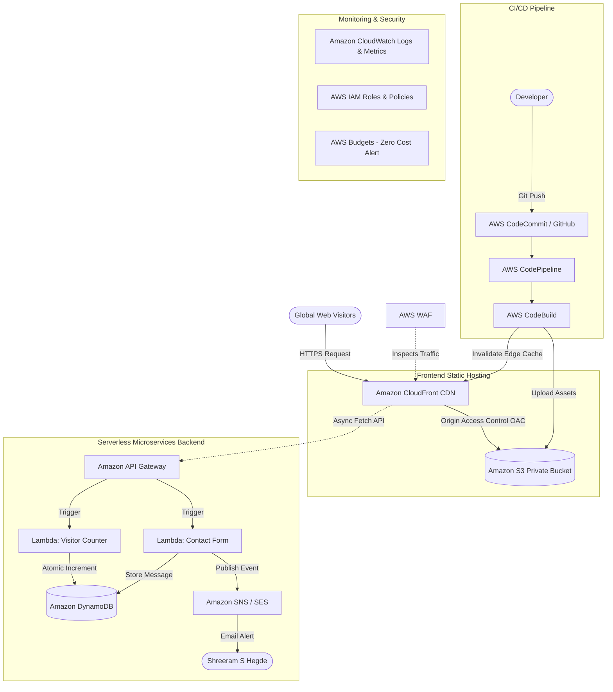

# Serverless Portfolio Hosting on AWS

**Cloud Computing Experiential Learning Project (BIS505)**  
**Department of Information Science and Engineering**  
**The National Institute of Engineering (NIE), Mysuru**  

---

| Student Name | USN | Academic Year | Guide |
| :--- | :--- | :--- | :--- |
| **Shreeram S Hegde** | **4NI24IS187** | 2026 – 2027 (5th Sem, Sec D) | **Ms. Prajakta M** (Assistant Professor) |

---

## 🎯 Project Goal & Abstract

The primary objective of this project is to architect, build, and deploy an enterprise-grade, highly available, secure, and cost-effective **Serverless Portfolio Web Application** entirely on Amazon Web Services (AWS) without provisioning or managing a single virtual machine (EC2).

While the foundational synopsis introduced static hosting via **Amazon S3** and **Amazon CloudFront**, this implementation maximizes the utilization of native AWS cloud services to demonstrate an end-to-end, real-world cloud architecture. It incorporates:
1. **Static Content Delivery**: Zero-maintenance, globally distributed web hosting with edge caching.
2. **Serverless Dynamic Backend**: Real-time cloud visitor counter and contact form processing using event-driven microservices.
3. **Enterprise Security**: CloudFront Origin Access Control (OAC), private S3 buckets, AWS WAF (Web Application Firewall), and least-privilege IAM policies.
4. **DevOps & Automation**: End-to-end CI/CD pipeline using AWS CodePipeline and AWS CodeBuild for automated building, S3 syncing, and CloudFront cache invalidation on git push.
5. **Observability & Governance**: Amazon CloudWatch alarms, structured logging, and AWS Budget alerts to maintain a 100% Free-Tier-compliant $0.00 footprint.

---

## 🏗️ High-Level System Architecture

```
                       [ Global Visitors ]
                               |
                               | (HTTPS / TLS 1.3)
                               v
                     +-------------------+
                     |    Amazon Route53 | (DNS / Custom Domain)
                     +-------------------+
                               |
                               v
                     +-------------------+
                     |      AWS WAF      | (DDoS Protection / Rate Limiting)
                     +-------------------+
                               |
                               v
                     +-------------------+
                     | Amazon CloudFront | (CDN / Global Edge Locations)
                     +-------------------+
                       /               \
       Static Assets  /                 \ Dynamic API Calls
      (OAC Protected)/                   \ (CORS Enabled)
                    v                     v
         +--------------------+  +----------------------+
         |   Amazon S3 Bucket |  |  Amazon API Gateway  | (HTTP / REST API)
         |  (Private Storage) |  +----------------------+
         +--------------------+             |
                                            v
                                 +----------------------+
                                 |      AWS Lambda      | (Serverless Compute)
                                 | (Python 3.12 Runtime)|
                                 +----------------------+
                                       /          \
                        Store Messages/            \ Send Email Notification
                       & Page Views  /              \
                                    v                v
                        +---------------+   +----------------+
                        |Amazon DynamoDB|   |   Amazon SNS   |
                        | (NoSQL Store) |   | (Notifications)|
                        +---------------+   +----------------+
                                                    |
                                                    v
                                            [ Student Email ]

--------------------------------------------------------------------------------
               CONTINUOUS INTEGRATION & CONTINUOUS DEPLOYMENT (CI/CD)
--------------------------------------------------------------------------------
   [ Developer ] ---> git push ---> [ AWS CodeCommit / GitHub ]
                                             |
                                             v
                                  +----------------------+
                                  |   AWS CodePipeline   |
                                  +----------------------+
                                             |
                                             v
                                  +----------------------+
                                  |    AWS CodeBuild     |
                                  | - Lint & Validate    |
                                  | - Sync to S3         |
                                  | - Invalidate CDN     |
                                  +----------------------+
```

### Mermaid Architecture Flow



---

## 🛠️ Complete AWS Services Matrix (14 Services Used)

| Category | AWS Service | Role in this Project | Free Tier Eligibility |
| :--- | :--- | :--- | :--- |
| **Storage** | **Amazon S3** | Stores static web assets (`index.html`, `style.css`, `app.js`, images, resume PDF). Bucket remains 100% private. | 5 GB standard storage free |
| **Content Delivery** | **Amazon CloudFront** | Low-latency global Content Delivery Network (CDN) caching assets at 450+ edge locations with HTTPS encryption. | 1 TB data transfer out/month free |
| **Origin Security** | **CloudFront OAC** | Origin Access Control authenticates CloudFront requests to S3, ensuring direct S3 public access is blocked. | Included with CloudFront |
| **Security & SSL** | **AWS Certificate Manager (ACM)** | Issues and manages free SSL/TLS certificates for encrypted HTTPS web traffic. | 100% Free |
| **DNS Routing** | **Amazon Route 53** | Manages custom domain routing, health checks, and alias records pointing to CloudFront. | Pay per hosted zone ($0.50/mo) or free using `*.cloudfront.net` |
| **Firewall** | **AWS WAF** | Inspects incoming traffic, blocks malicious IPs, and enforces rate-limiting on contact form submissions. | Pay-per-rule / Free trial available |
| **API Management** | **Amazon API Gateway** | Managed HTTP/REST gateway providing secure, CORS-enabled endpoints (`/visitor-count`, `/contact`). | 1 Million API calls/month free |
| **Serverless Compute** | **AWS Lambda** | Event-driven microservices running Python code to update the visitor counter and process contact form submissions. | 1 Million requests & 3.2M sec compute/mo free |
| **NoSQL Database** | **Amazon DynamoDB** | Fully managed serverless NoSQL database storing visitor count atomically and persisting contact messages. | 25 GB storage & 25 WCU/RCU free |
| **Messaging** | **Amazon SNS** | Simple Notification Service to trigger instant email notifications when someone submits the contact form. | 1 Million publishes/month free |
| **Source Control** | **AWS CodeCommit / GitHub** | Secure Git repository hosting the portfolio source code and pipeline automation configuration. | Free tier eligible |
| **Build & Deployment** | **AWS CodeBuild** | Managed build service that validates code, synchronizes files to Amazon S3, and invalidates CloudFront cache. | 100 build minutes/month free |
| **CI/CD Orchestration** | **AWS CodePipeline** | Fully automated pipeline orchestrating the source retrieval, build, and zero-downtime deployment. | 1 active pipeline free/month |
| **Monitoring & Governance** | **Amazon CloudWatch & Budgets** | Centralized logs for Lambda/API Gateway, performance metrics, and automated billing alarms at $0.00. | 10 custom metrics & alarms free |

---

## 📂 Documentation Directory

To make execution, evaluation, and viva presentations seamless, the project is documented across dedicated, specialized guides:

1. [**ARCHITECTURE_AND_SERVICES.md**](file:///home/shreeram/Projects/PortFolio/ARCHITECTURE_AND_SERVICES.md)  
   *Deep technical dive into all 14 AWS services, why each was selected, architectural trade-offs, and serverless vs. EC2 comparisons.*

2. [**STEP_BY_STEP_IMPLEMENTATION_GUIDE.md**](file:///home/shreeram/Projects/PortFolio/STEP_BY_STEP_IMPLEMENTATION_GUIDE.md)  
   *Hands-on, copy-paste implementation guide covering S3 bucket setup, CloudFront OAC, DynamoDB tables, Lambda functions, API Gateway routes, and CloudWatch alarms.*

3. [**CICD_PIPELINE_GUIDE.md**](file:///home/shreeram/Projects/PortFolio/CICD_PIPELINE_GUIDE.md)  
   *Dedicated guide covering AWS CodePipeline, AWS CodeBuild, and AWS CodeCommit / GitHub integration, complete with `buildspec.yml` and automatic CloudFront cache invalidation.*

4. [**BACKEND_SERVERLESS_CODE.md**](file:///home/shreeram/Projects/PortFolio/BACKEND_SERVERLESS_CODE.md)  
   *Production-ready Python Lambda scripts for atomic visitor counting, contact form submission, DynamoDB schema definitions, and IAM JSON policies.*

---

## 🌟 Why This Architecture Excels for Cloud Experiential Learning

1. **Addresses Cloud Anti-Patterns**: Many beginner projects leave S3 buckets publicly readable. This architecture implements **Origin Access Control (OAC)**, making S3 completely private while allowing CloudFront edge access.
2. **Beyond Static Hosting**: Incorporates the acclaimed **Cloud Resume Challenge** paradigm by building a live, dynamic serverless visitor counter and contact form microservice.
3. **DevOps Maturity**: Eliminates manual file uploads to S3. Any `git push` triggers automated build steps and instantaneous cache invalidation via **AWS CodePipeline**.
4. **Zero Infrastructure Cost**: Designed to strictly fit inside the **AWS Free Tier**, incurring **$0.00/month** in operating expenses.
5. **No Virtual Machine Maintenance**: Eliminates OS patching, security hardening, load balancer configuration, and idle compute costs associated with Amazon EC2.
